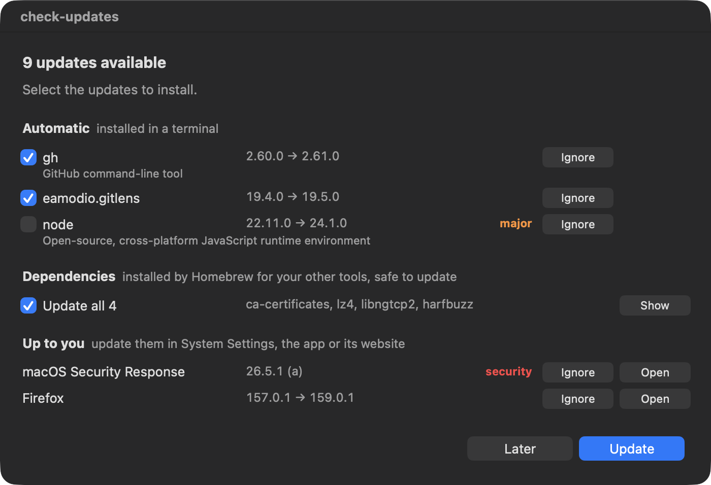

# check-updates

Finds everything that is out of date on a Mac — macOS, apps, command-line tools — and lets you pick what to update from a checklist. Failed updates are reported, with an optional AI diagnosis.



Like [Topgrade](https://github.com/topgrade-rs/topgrade), but it checks first and lets you pick; like [Latest](https://github.com/mangerlahn/Latest), but it also covers your command-line tools.

## Install

```sh
brew install antoinecau/tap/check-updates
```

Run `check-updates` whenever you want. It checks every source in parallel, shows its progress, then opens a checklist in up to three groups:

- **Automatic** (ticked by default, except major versions): installed right away in your terminal, so you can follow them and type your password when needed;
- **Dependencies**: libraries Homebrew installed for your other tools, folded into one **Update all** line (**Show** lists them);
- **Up to you**: macOS and apps that update themselves — each has an **Open** button for System Settings, the app or its website.

Homebrew updates say what they are and, for dependencies, which of your tools use them (“used by git, php”), so you know what you are updating.

Major versions are tagged **major**, and updates Apple labels as security fixes are tagged **security**. **Ignore** hides a version until a newer one comes out (`check-updates ignored` lists them, `check-updates unignore <name>` brings one back). The daily check only opens the window when something new showed up since the last list.

If an update fails, you get a summary with buttons to open the log or ask an AI CLI (Claude Code, Codex, Gemini…) to diagnose it. After a Homebrew update, old downloads are cleaned up and the freed space is shown. `check-updates history` lists what was updated and when.

## What it checks

Only what is installed on the Mac is checked.

| Source | How |
|---|---|
| macOS, Safari, Command Line Tools | `softwareupdate --list` (installed from System Settings) |
| Homebrew formulae and casks | `brew outdated --json=v2` |
| Apps installed without Homebrew | version compared with the public [Homebrew cask catalog](https://formulae.brew.sh), otherwise with the app's Sparkle feed |
| App Store | [`mas`](https://github.com/mas-cli/mas), if installed |
| Node.js (nvm), npm and pnpm globals | `nvm`, `npm outdated -g`, `pnpm outdated -g` |
| Bun and Deno (installed with their own script) | version compared with the latest release, updated with `bun upgrade` / `deno upgrade` |
| Python tools | `pipx`, `uv tool` (compared with PyPI) |
| Rust | `rustup check`, `cargo install` binaries (compared with crates.io) |
| Ruby gems, mise, Composer, Oh My Zsh | `gem outdated`, `mise outdated`, `composer`, git |
| TeX Live (MacTeX, BasicTeX) | `tlmgr update --list`, and new yearly releases |
| GitHub CLI extensions | `gh extension upgrade --dry-run` |
| VS Code extensions | compared with the Visual Studio Marketplace (stable versions that work with your VS Code) |

Nothing is ever installed without you ticking it.

## Commands

```
check-updates                      check now, write the report, then offer the updates
check-updates --list               reopen the list from the last check
check-updates --quiet              check and write the report, no window
check-updates doctor               make sure every part still works on this Mac
check-updates schedule on [HH:MM]  check every day (default 9:30)
check-updates schedule off         stop the daily check
check-updates schedule             show whether the daily check is on
check-updates ignored              list the updates you chose to ignore
check-updates unignore <name>      show an ignored update again (--all for every one)
check-updates history [N|--all]    what was updated and when (last 10 runs by default)
```

The daily check is off until you turn it on. If the Mac is offline when it runs (often right after waking up), it waits up to 30 minutes for the network, then skips that day quietly. When nothing is new, it only sends a notification: click it to reopen the list (the first time, macOS asks whether check-updates may send notifications).

Reports are written to `~/Library/Logs/check-updates/latest.md`, settings live in `~/.config/check-updates/config` (terminal, AI CLI, Homebrew cleanup, sources to skip).

## AI diagnosis and privacy

When an update fails, **Diagnose with…** hands the error to an AI CLI installed on your Mac (Claude Code, Codex, Gemini, or any command set with `AI_COMMAND`). Before anything is sent:

- only the output of the failed steps goes out, not the full log;
- your home folder, user name and machine name are masked, and so are known secret formats (credentials in URLs, bearer tokens, GitHub/npm/OpenAI/Anthropic/AWS/Slack/Stripe keys, `password=`, `token=`…);
- a window says what will be sent, with **Show What's Sent** to read it first.

Masking cannot catch every possible secret. Set `AI_COMMAND="none"` in `~/.config/check-updates/config` to remove the button.

## Staying reliable

Each parser rejects output it does not recognise: a source whose format changed is reported as **failed** instead of silently showing “up to date”.

- `check-updates doctor` tests every part on your Mac (Python, the windows and notifications, the network, the cask catalog, each source) — run it after a macOS or Homebrew upgrade.
- CI runs the parser tests and `doctor` against real tools on GitHub's macOS runners every Monday, to catch upstream changes early.

## Adding a source

Drop a file in `libexec/check-updates/sources/NN-name.zsh` defining:

- `src_available` — exit 0 if the tool is installed;
- `src_check` — print one `label<TAB>command` line per update (`#<TAB>text` for a note), exit non-zero if the check failed.

Add a `title_name` entry in `libexec/check-updates/messages.zsh` and a test in `tests/run.zsh`.

## Releasing

Bump `VERSION` in `bin/check-updates`, add an entry to `CHANGELOG.md`, then push a tag:

```sh
git tag v0.4.1 && git push origin main v0.4.1
```

The release page is created from the changelog entry right away. Within the hour, the tap's workflow copies `packaging/homebrew/check-updates.rb` to the tap with the new archive URL and sha256 (run it right away with `gh workflow run update-check-updates.yml -R AntoineCAU/homebrew-tap`).

## License

MIT
